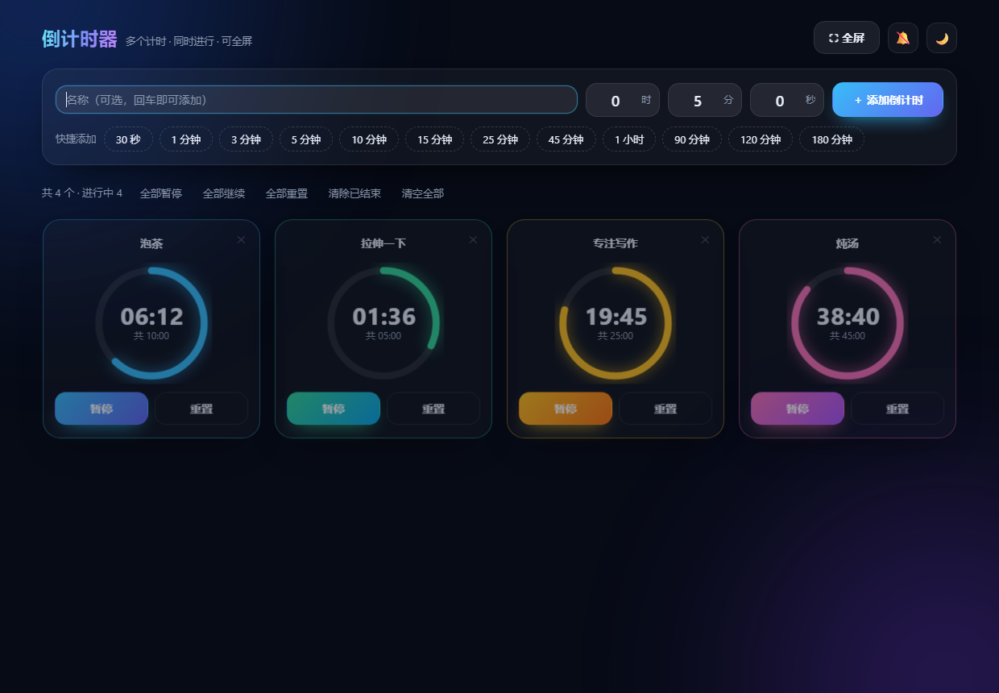
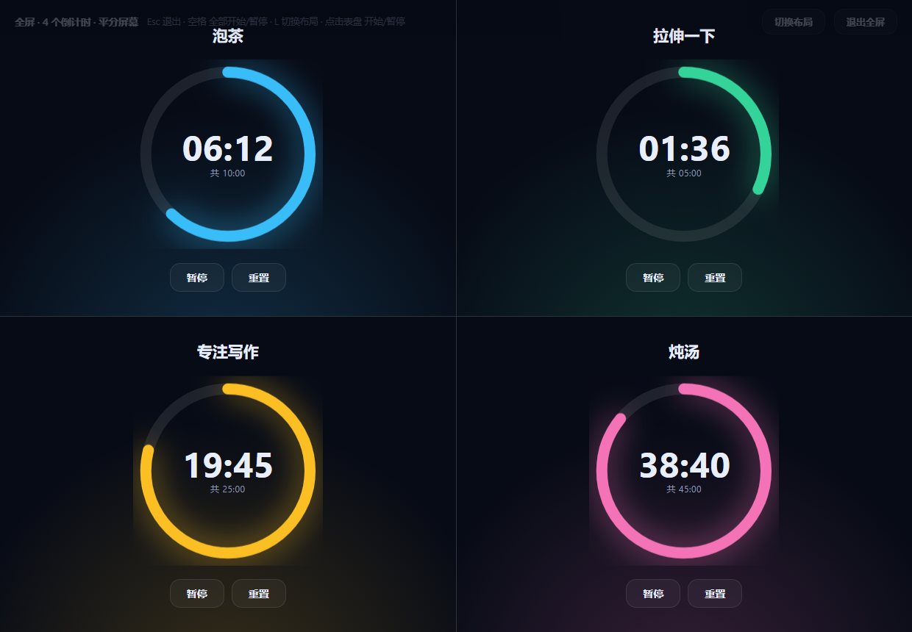
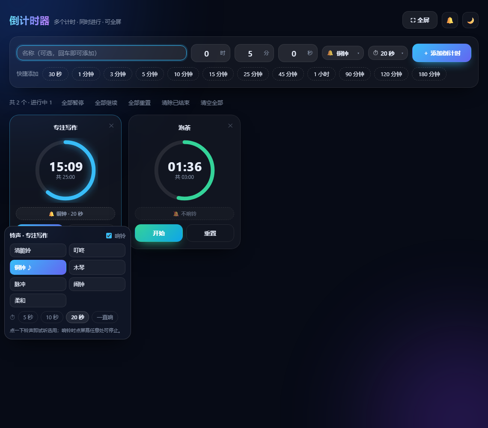

# 倒计时器 Countdown Timer

一个极简单文件倒计时器：**自定义时长 · 命名 · 暂停 / 继续 · 重置 · 多计时并行 · 全屏平分屏幕 · 每个计时器独立铃声**。

## 快速开始

1. 下载 [`timer.html`](timer.html)（就这一个文件，无任何外部依赖、不联网、不上报任何数据）
2. 双击它，用浏览器打开即可使用

想要独立窗口（无地址栏 / 标签栏）和桌面图标，见下面的「使用」。

## 使用

双击桌面上的 **倒计时器** 快捷方式即可（Edge 应用模式，独立窗口，无地址栏/标签栏）。

如果快捷方式丢了、或者把整个文件夹挪了位置，双击本文件夹里的 `create-shortcut.cmd` 重新生成即可。

## 功能

| 功能 | 说明 |
| --- | --- |
| 自定义时长 | 先填名称（可留空），再输入「时 / 分 / 秒」，回车或点「＋ 添加倒计时」 |
| 命名 | 添加时可填名称；建好后点卡片顶部的名字也能随时改，自动保存 |
| 快捷添加 | 30 秒 / 1、3、5、10、15、25、45 分钟 / 1、1.5、2、3 小时（90 / 120 / 180 分钟），点一下即添加并开始 |
| 暂停 / 继续 | 每个计时器独立控制，剩余时间精确保留 |
| 重置 | 回到设定时长，不删除 |
| 多计时 | 可同时运行任意多个，进度环各自配色区分 |
| **全屏平分屏幕** | 点「⛶ 全屏」把 1~4 个倒计时铺满整块屏幕；2 个左右分屏、3 个三列、4 个 2×2，每个格子等分 |
| 全屏选角 | 计时器超过 4 个时，卡片左上角出现 ⛶ 开关，自行挑选哪 4 个上全屏 |
| 全屏布局 | 全屏内可「切换布局」（分屏 / 叠放），快捷键 `L` |
| 批量操作 | 全部暂停 / 全部继续 / 全部重置 / 清除已结束 / 清空全部 |
| 结束提醒 | 卡片闪烁 + 窗口标题变「⏰ 时间到」+ 铃声提醒（见下） |
| **铃声跟着每个计时器走** | 铃声、响铃时长、开关都是每个倒计时自己的，互不影响：一个用闹钟响 20 秒，另一个可以不响铃 |
| 添加时就选好 | 输入时长那一行右侧的 🔔 和 ⏱ 下拉框，添加前就能挑好铃声与时长（会记住上次的选择） |
| 随时单独改 | 卡片上的「🔔 铜钟 · 20 秒」按钮点一下弹出该计时器自己的设置面板 |
| 铃声种类 | 7 种：清脆铃 / 叮咚 / 铜钟 / 木琴 / 脉冲 / 闹钟 / 柔和（外加「不响铃」），点一下即试听 |
| 响铃时长 | 5 秒 / 10 秒 / 20 秒 / 一直响，铃声会循环播放直到时长用完 |
| 停止响铃 | 响铃时屏幕下方出现「🔔 正在响铃 · 点此停止」，点它或点屏幕任意处即可停 |
| 全部静音 | 右上角 🔔 一键让所有计时器都不出声（各计时器自己的设置会保留） |
| 自动保存 | 计时器与剩余时间（连同各自的铃声设置）存在本地，关掉再打开自动恢复 |
| 其他 | 明 / 暗主题切换、标签页实时显示最近一个倒计时 |

计时精度基于系统时钟（`Date.now()`）而非累加，长时间运行不会漂移。

全屏平分屏幕（4 个 2×2）与单个计时器的铃声面板：

### 快捷键

| 键 | 作用 |
| --- | --- |
| `Enter` | 在任一输入框里回车 = 添加倒计时 |
| `F` | 进入全屏模式（主界面下） |
| `Esc` | 退出全屏模式 |
| `空格` | 全屏模式下：全部开始 / 全部暂停 |
| `L` | 全屏模式下：切换布局（分屏 ⇄ 叠放） |
| 点击表盘 | 全屏模式下：单个计时器开始 / 暂停 |

## 文件说明

- `timer.html` —— 应用本体（单文件，无任何外部依赖，可单独拷走使用）
- `timer-icon.ico` —— 应用图标（桌面快捷方式使用，由 `make_icon.py` 生成）
- `create-shortcut.cmd` / `create-shortcut.ps1` —— 生成桌面快捷方式
- `make_icon.py` —— 重新生成图标的脚本（需要 pillow + numpy）
- `icon-preview.png` / `preview.png` / `preview-fullscreen.png` / `preview-ringtone.png` —— 图标与界面预览图

## 改配色 / 改时长预设 / 加铃声

打开 `timer.html`：

- 快捷时长的按钮：搜 `PRESETS`，格式为 `["显示文字", 秒数]`
- 每个计时器的配色：搜 `PALETTE`，每项是一对渐变色 `["#主色", "#辅色"]`
- 铃声列表：搜 `RINGTONES`，加一项即可出现在下拉框和面板里。`notes` 里每个音是
  `[起始偏移秒, 频率Hz, 持续秒, 音量, 波形]`（波形可为 `sine`/`triangle`/`square`/`sawtooth`），
  `period` 是整段音型的循环周期（秒），会一直循环到「响铃时长」用完
- 响铃时长档位：搜 `RING_DURS`，格式为 `[秒数, "显示文字"]`，`0` 表示一直响
- 每个计时器的铃声字段：`ringOn`（开关）/ `ringId`（铃声 id）/ `ringDur`（秒），随计时器一起存本地
- 全屏最多显示几个：搜 `MAX_FS`（默认 4）

## 说明

- 铃声由 Web Audio 现场合成（没有任何音频文件），所以首次点「开始」或点铃声试听时需要浏览器允许音频播放；没播出声就点一下页面再试。
- 多个计时器同时到点时会响其中一个的铃声（不会叠在一起炸耳朵），其余计时器的设置不受影响。
- 数据保存在浏览器的本地存储里，清理浏览器数据会一并清除。
- 若用记事本编辑 `create-shortcut.ps1`，请另存为 **UTF-8 带 BOM**，否则 Windows PowerShell 会按 GBK 解析导致中文乱码。
- 图标文件若带 Windows「低完整性级别」标记（在 DSH 沙箱工作区里新建的文件都会被打上这个标记），系统外壳会拒绝从中加载图标，桌面快捷方式会退化成一张通用白纸图标；`create-shortcut.ps1` 已经会自动把该标记提升到 Medium，重跑一次脚本即可修好。
